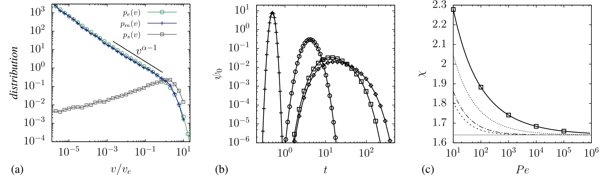
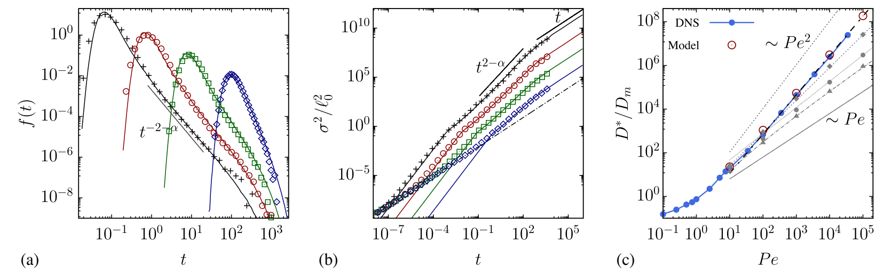
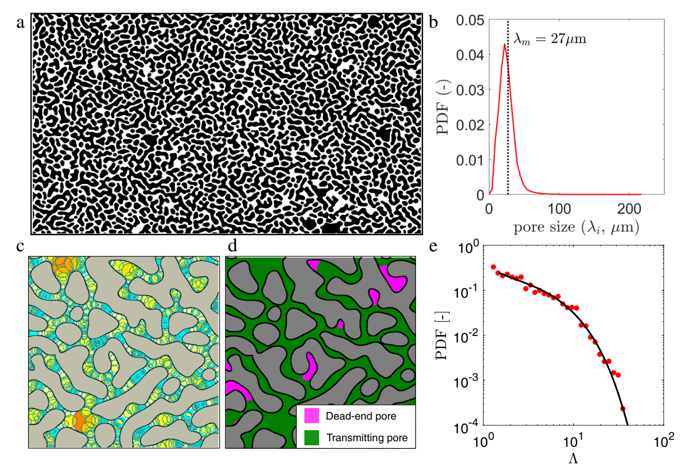
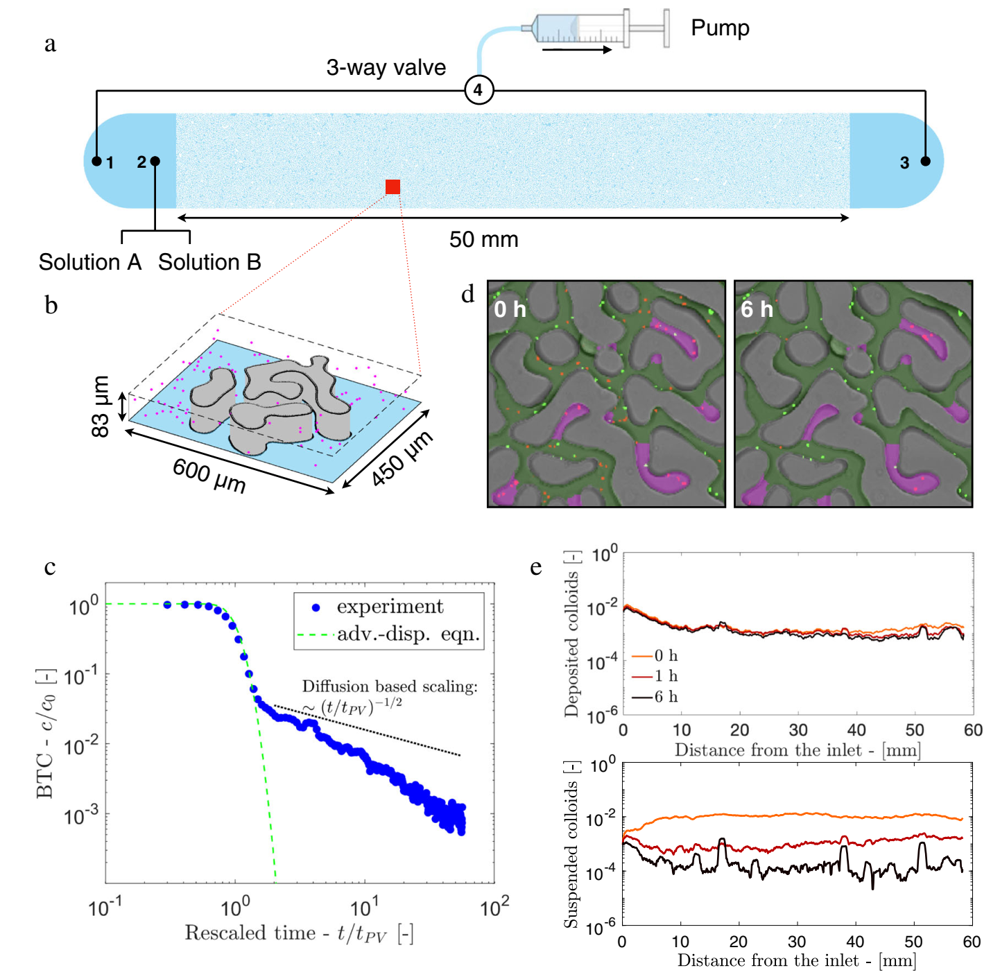
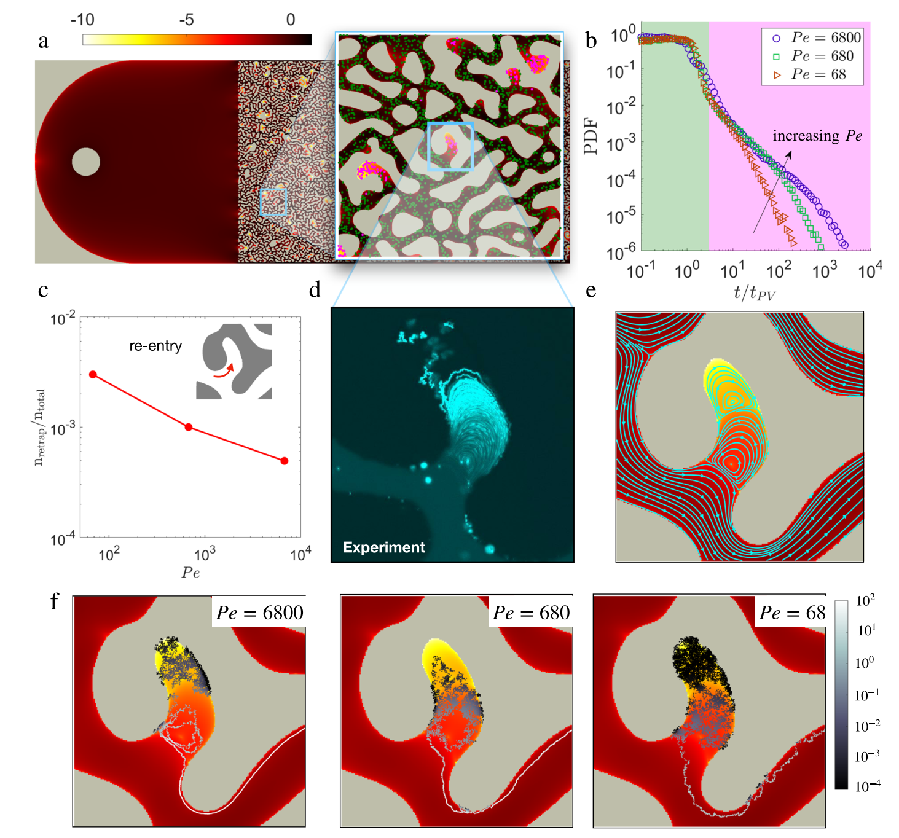
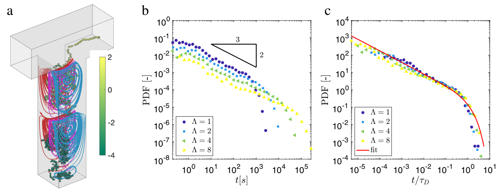

# 文献摘要

考虑上具体结构中颗粒的运动。把路径划分成长度为 $\ell_v$ 的小段，就近似认为不同段的速度 $v_n$、通过时间 $\tau_n$ 可以作为相互独立的随机变量（只有对流时，有 $\tau_n=l_v/\ell_n$，但是通过时间还受到扩散的影响）。于是有以下随机过程：

$$
s_{n+1}=s_n+l_v,\qquad
t_{n+1}=t_n+\tau_n.
$$

这个粗粒化模型暂时不记录段内的细节，只记录各段通过的时刻：$n_t=\max\{n\mid t_n\le t\}, s(t)=s_{n_t}$。类似于将孔隙空间使用长度为 $\ell_v$，速度为 $v_m$ 的相连导体表示。定义对流曲折度 $\boxed{\chi_a=\frac{\langle v_e\rangle}{\bar u}}$，分子是平均流速，分母为平均流向的分量。加入扩散后，主要有三个影响：1、扩散让粒子跨越流线，经历不同的流速；2、扩散让粒子跨越流线，经历不同的流速（纯扩散的特征时间 $\tau_D\sim\frac{\ell_v^2}{D_m}$，对流特征时间 $\tau_{adv}=\ell/v$，$\tau_{adv}<\tau_D$ 也就是 $\boxed{v<\frac{D_m}{l_v}}$时，粒子的通过过程就主要由扩散控制）；3、扩散增加横向和往返运动，使有效路径更曲折。

先把复杂孔隙简化成具有泊肃叶流动的孔道，对于窄孔道，粒子来得及横向扩散，充分经历整个速度分布，对于宽孔道，即使不能充分横向混合，扩散也能把粒子从近壁慢区带走，所以颗粒在一段导体中的速度完全由平均速度 $v_m$ 控制。

平均速度与局部速度的分布关系：

$$
\boxed{
p_e(v)=\int_0^\infty p_m(V)\,
\frac{1}{2V}H(2V-v)\,\mathrm dV
}
$$

颗粒进入子管道概率由速度（或者说通量）决定：

$$
\boxed{
p_s(v)=\frac{v\,p_m(v)}{\langle v_m\rangle}
},
\qquad
\langle v_m\rangle=\int_0^\infty v\,p_m(v)\,\mathrm dv.
$$

接下来考虑单个一维管道中扩散对于通过时间 PDF $\psi_0(t|v)$ 的影响。对于较大的 Peclet 数 $Pe_v=v\ell_v/2D$，它在对流时间处有一个峰值，并且在扩散时间处以指数形式截止。平均的通过时间为（此处为引用）：

$$
\langle \tau \mid v \rangle
=
\tau_v
\frac{\mathrm{Pe}_v-\exp(-\mathrm{Pe}_v)\sinh(\mathrm{Pe}_v)}
{\mathrm{Pe}_v}
$$

对于整个网络的通过时间概率：

$$
\boxed{
\psi(t)=
\int_0^\infty
\frac{v p_m(v)}{\langle v_m\rangle}
\,\psi_0(t\mid v)\,\mathrm dv.
}
$$

类似于 Darcy 定理，平均流向速度可以表示为 $\boxed{\bar u=\frac{l_v}{\chi\,\langle\tau\rangle}}$，由此可以计算曲折度。其具体表达式：

$$
\chi
=
\chi_a
\left[
1-\int_0^\infty
p_m(v)\,
\frac{e^{-\mathrm{Pe}_v}\sinh(\mathrm{Pe}_v)}
{\mathrm{Pe}_v}
\,\mathrm dv
\right]^{-1}
$$

使用以上理论来量化和阐明异常和正常的水动力弥散行为。这里专注于速度 PDF，它表现为幂律 $p_m{v}\sim v^{\alpha-1}$（对于直管 $\alpha=1$）。对于所研究的 Berea样本，$\alpha\approx0.35$，如上图a所示。对应的通过时间 PDF 表现为 $\psi(t)\sim(t/\tau_v)^{-2-\alpha}, t\ll\tau_D$，并在 $t\gg\tau_D$ 时指数快速下降。

进一步研究两个可观测量：1、首次到达时间 $f(t)$，2、流向位置方差 $\sigma^2(t)=\langle x(t)^2\rangle-\langle x(t)\rangle^2$。基于以上分析，已经知道当观测时间远小于 $\tau_D$ 时，尚未进入扩散截断所控制的阶段，输运主要受幂律部分影响。这里给出 $f(t)\propto t^{-2-\alpha}$（此处为引用），并且在 $t\gg \tau_D$ 时保留幂律尾部。另一方面 $\sigma^2(t)\propto t^{2-\alpha}$（此处为引用），正常弥散对应 $\sigma^2(t)\propto t$，而这里 $1<2-\alpha<2$，属于超扩散。然而当 $t\gg\tau_D$ 时，扩散截断了极长的通过时间，粒子不会持续受到没有上限的幂律滞留影响，经过足够长时间，每个粒子经历很多次快慢交替，最初速度和个别滞留事件的影响逐渐被平均掉。于是 $\boxed{\sigma^2(t)\simeq2D^*t}$，其中 $D^*$ 是长期有效水动力弥散系数。**粒子的长期运动可以由同一套平均输运统计描述**。同时还能得到 $\frac{D^*}{D_m}\sim\mathrm{Pe}^{\,2-\alpha}$。

上图 b 中的方差大致经历三个阶段：

- 早期弹道阶段	$\sigma^2\propto t^2$	粒子尚未充分更换速度，各自以不同速度前进
- 中间反常弥散阶段	$\sigma^2\propto t^{2-\alpha}$	快慢路径与长滞留使粒子云持续展宽
- 长期正常弥散阶段	$\sigma^2\propto t$	扩散截断长滞留，多步运动实现统计平均

## Structure induced laminar vortices control anomalous dispersion in porous media

作者采用的是**固态退润湿**（solid-state dewetting）方法：对单晶半导体薄膜进行退火，薄膜重新组织，形成不规则的岛状结构。其平面形貌具有类似旋节分解（spinodal decomposition）形成的曲折、相互嵌套的特征。贯通孔隙（TP）和盲端孔隙（DEP）分别约占总孔隙体积的 $91\%$ 和 $9\%$。孔隙率$\phi=0.39$，介质的孔隙非常均匀，在平均孔径 $\lambda_m$ 附近有一个很强的峰值（见下图b）。定义 $\
\Lambda=A/\lambda_m^2$，其中 $A$ 是单个盲端的平面面积，其跨度在1-30范围内，并遵循指数截止的幂律分布（见下图e）。

**为什么要选择这类结构？**

作者想研究的是：**盲端孔隙中的流动，如何影响颗粒滞留和释放**，因此，需要一种同时具备以下特点的多孔介质：
- 有贯通网络，能够持续输送流体；
- 有足够多的盲端，能够储存、滞留颗粒；
- 盲端的深浅不一，能体现结构无序性；
- 主通道的孔径又相对集中，便于辨认盲端结构带来的影响。
固态退润湿产生的这类不规则图案，恰好同时具有这些特点。作者还强调，这类类似旋节分解的形貌在多种自然和人工材料中都会出现，因此具有一定代表性。

使用直径为 $0.5\,\mu\mathrm{m}$ 的聚苯乙烯胶体颗粒，将其悬浮在水和重水的混合液中，尽量匹配液体与颗粒的密度，减弱重力沉降。
然后，以 $0.2\,\mu\mathrm{L/min}$ 的流量，连续向多孔介质输入这种悬浮液 24小时，另外使用相同溶剂、但是不含颗粒的B溶液冲洗：显示 B → 2 → 1 → 4 路径冲洗入口附近的液体，然后切换为 B → 2 → 多孔介质 → 3 → 4 开始冲洗（正式冲洗，开始计时）。

上图 c 称为突破曲线（breakthrough curve，BTC，泛指出口处的示踪物信号随时间变化的曲线），表示为出口颗粒数浓度相对于初始参考浓度的比例 $c(t)/c_0$ 关于特征时间 $t/t_{PV}$ 的变化，其中 $t_{PV}=V_{pore}/Q$。实验测得数据呈现两个阶段：

**早期：贯通网络中的颗粒被快速冲走**。最初出口浓度接近初始值，因为出口附近仍然是原来的悬浮液；随后干净液体逐渐替换它，出口浓度迅速下降。约在前两个孔隙体积内，经典对流–弥散模型能较好地描述这个过程，拟合出的宏观弥散系数是 $D^*=0.03\,\mathrm{mm^2/s}$；**晚期：出口仍然持续出现少量颗粒**。当 $t/t_{\mathrm{PV}}>2$ 后，绿色虚线已经急剧下降，但实验蓝点保持明显的长尾。也就是说，即使主体悬浮液已经冲走，仍有某些地方不断缓慢释放颗粒。

上图 d 中红点表示悬浮颗粒，绿点表示沉积、固定的颗粒，其支持了判断：c 中长尾中的颗粒主要来自盲端的缓慢释放。从 e 能看出，冲洗并没有显著的新增沉积。

二维仿真结果：

如上图 b，也表现出实验中观察到的过渡时间之前，TP中的颗粒被持续冲洗；和过渡时间 $t/t_{PV}=2$ 之后，DEP颗粒被释放。另一方面，c表示 DEP 中回流的颗粒比例是很小的。

如上图 c,d，DEP中存在着层流涡旋级联，颗粒只能通过扩散逃脱（见上图f，初始位置深入DEP的颗粒轨迹，颜色为局部 Pectel 数 $Pe^*=\lambda_mv_p/D$，其中 $v_p$ 是局部速度）。

为了理解这种沿着封闭流线转动和跳跃的机制是如何控制 BTC 的后期行为的，首先对于单个 DEP 中的输运进行建模，即一个连接着自由管道的腔体，并且变换腔体的相对大小 $\Lambda=l_d/w$（二维与三维仿真）。见下图 a，为$\Lambda=4$ 的例子。无论是 3D 还是 2D 的仿真，都显示出多孔介质中 DEP 中类似的行为：颗粒一开始各向同性扩散（$Pe^*\ll 1$）直至腔体的上方，此处运动成为沿着涡旋流线的对流与促进流线交换扩散之间的竞争（$Pe^*\sim1$），最后颗粒脱离腔体，进入管道内（$Pe^*\gg 1$）。

仿真得到的 BTC 见下图 b,c。其中 b 中可以看出，都随时间有个幂律关系 $t^{-2/3}$，并带有指数截断。c 中时间使用扩散时间 $\tau_D=(\lambda_m\Lambda)^2/D$ 放缩，于是所有数据都集中在主曲线上：

$$
g(t)=\frac{(t/\tau_D)^{-2/3}\exp(-t/\tau_D)}{\Gamma(1/3)}
$$

另外二维仿真也得出类似的结论，说明空腔的厚度并不影响颗粒在此处的输运（另外与形状也无关）。基于以上建立了一个一维统计模型：

$$
F(t)=
\underbrace{
(1-\alpha)\frac{1}{L}\int_0^L \mathrm{d}x\,f_0(t,x)
}_{F_{\mathrm{TP}}}
+
\underbrace{
\alpha\int_0^\infty \mathrm{d}\tau\,
g(t/\tau)\tau^{-1}f_D(\tau)
}_{F_{\mathrm{DEP}}}.
$$

其中 $\alpha$ 为初始胶体分布于 DEP 中的占比。$f_0(t,x)$ 表示：从距离出口 $x$ 处出发，只经历对流和弥散的颗粒，在时刻 $t$ 流出的概率密度，$f_D$ 是 DEP 特征扩散时间概率密度，由之前 $\Lambda$ 的 PDF 换算而来。

