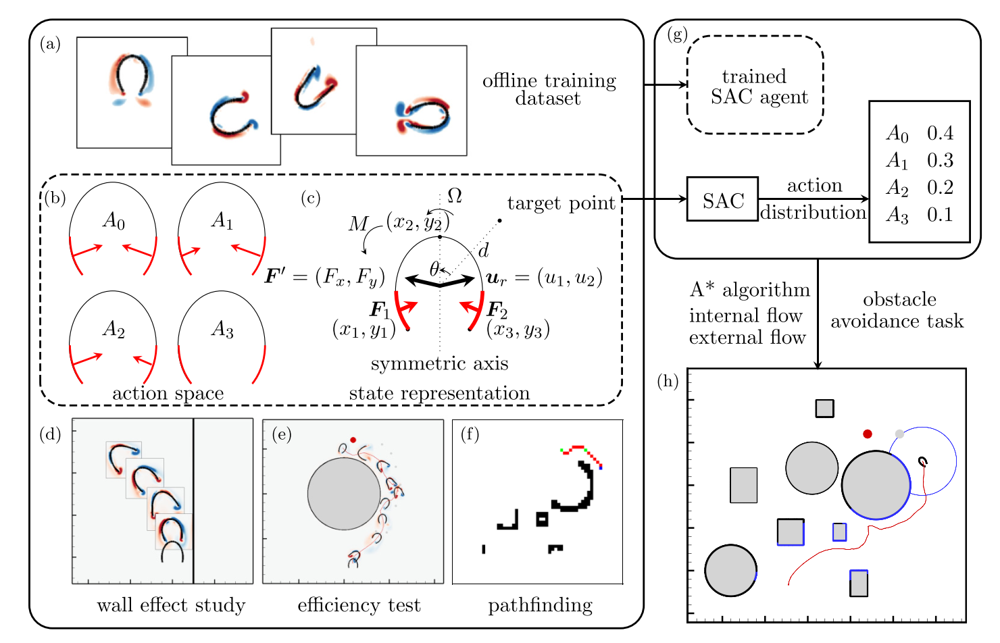
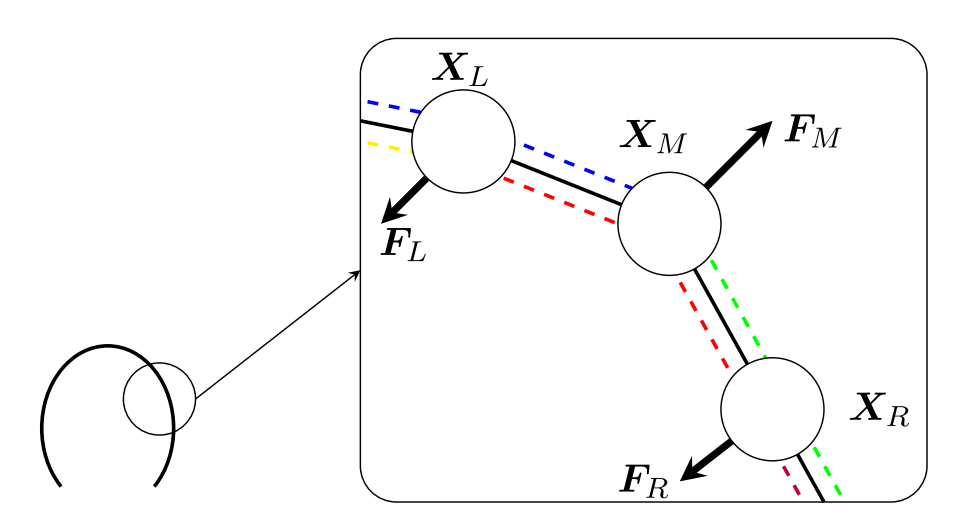

# 文献摘要

## Pilot-guided deep reinforcement learning for navigation of a jellyfish-like swimmer in flows with obstacles

首先分别在无壁面环境和有简单直壁的环境中，让水母执行随机动作（见上图b，共有四种动作，它们是通过调整力的施加实现的），收集这些记录。随后利用记录训练控制器（得到在不同状态空间下各种动作的选择概率，见上图g）。水母的二维模型如下图所示：

很简单的拉伸+弯曲弹簧。

### 什么是SAC？

**SAC 是 Soft Actor-Critic，中文通常译为“软演员—评论家算法”，是一种强化学习算法**。它的作用是：根据当前情况，学会选择对长期目标有利的动作。

**1．Actor：“决策者”，负责选动作**

Actor 是一个神经网络。它读取水母当前的信息，例如目标方向、速度、身体形状、受力和力矩，然后输出四个动作的概率。

**2．Critic：“评价者”，负责判断动作的长期价值**

Critic 也是神经网络。它回答的问题是：
当前处于状态 $s$，如果先采取动作 $a$，之后继续按当前策略行动，预计能获得多少累计奖励？

这个预测通常记作：
$$
Q(s,a).
$$
这里最重要的是累计奖励，而不仅是眼前这一步的评分。

举个假设例子：水母靠近障碍物时，继续前进可能让它暂时更接近目标，但随后难以转向；现在先右转，短时间内未必靠近目标，却可能使后续绕行更加顺利。

如果 Critic 学得足够好，它就应该给后者更高的长期评价。

**3．Actor 和 Critic 怎样相互帮助？**

训练数据包含这样的记录：
$$
\text{当前状态 }s
\;\longrightarrow\;
\text{动作 }a
\;\longrightarrow\;
\text{奖励 }r,\ \text{下一状态 }s'.
$$

训练时：
- Critic 改进自己的预测：结合实际获得的奖励，以及对后续收益的估计，修正 $Q(s,a)$。
- Actor 改进动作选择：提高 Critic 认为更有利的动作的选择概率。
需要区分：奖励规则由研究者设定，Critic 学的是预测长期收益。 在这篇文章中，奖励主要鼓励朝向目标、向目标前进、缩短目标距离。

**4．“Soft”是什么意思？**

这是 SAC 的关键特点：它既希望获得高奖励，也鼓励策略保留一定的动作多样性。

如果训练初期稍微发现右转有用，就永远只右转，可能错过更好的选择。SAC 因此在优化目标中加入“**策略熵**”：
$$
\text{优化目标}
=
\text{预期累计奖励}
+
\alpha\,\text{策略熵}.
$$
可以把“熵”理解为动作选择的不确定程度：
- 一个动作概率为 1，其余为 0：熵低，选择完全确定；
- 四个动作都有一定概率：熵较高，选择更多样。
系数 $\alpha$ 控制对这种多样性的重视程度。它并不是要求永远随机行动，而是在提高收益的同时，避免策略过早变得过于单一。

这种方法是 **off-policy** 的，旧版本控制器里（或者随机动作产生的）的经验被存放在 replay buffer（经验回收缓冲区）里。这样可以做到**较高的样条利用率**。

另外这种方法是 **offline** 的，也就是训练期间不采集新的数据，并没有与环境实时的交互。

实际上的做法如下：

**第一步：用随机动作收集数据**

让水母在不同条件下随机选择前进、转向、漂移，运行CFD，记录相应的 $(s,a,r,s') = (\text{当前状态},\ \text{采取的动作},\ \text{得到的奖励},\ \text{下一状态})$

随机动作不一定能很好地完成导航，但可以提供不同动作后果的样本。

**第二步：做数据增强**

本文的一个做法是改变记录中的虚拟目标位置。

比如，一次模拟中水母右转了。这段实际运动已经算出来：
- 如果目标在右边，这个动作可能得到较高评分；
- 如果目标在左边，同样的动作可能得到较低评分。
目标只是任务指定的位置，不会直接改变流体力学。因此，可以保留同一段已计算的物理运动，重新计算目标距离、方向和奖励，生成新的训练样本。

这增加的是不同目标条件下的训练样本，没有凭空产生新的流场。

**第三步：在固定数据集上训练SAC**

之后反复读取这些经验，更新Actor和Critic，不再为了每轮网络训练重新运行CFD。

这里的节省来自重复利用已经付出计算成本的数据，并把流场计算与网络训练分开。代价是：如果固定数据中缺少某类关键情况，控制器就可能学不好；离线训练时也不能自行通过新的模拟补足这些经验。

另外在 SAC 完成之后会进行**导航测试**，它的作用是检验：已经学好的控制器，放进有障碍物的环境中，能否真正把水母控制到目标位置。在水母运动的时候会加入一个 **pilot**，它的作用是调整输入状态中的距离、角度参数，实际上就是水母一直朝着 pilot 移动（根据 SAC 训练出来的控制器），而每一步 pilot 的位置是根据某个算法以及考虑视线因素得到的。