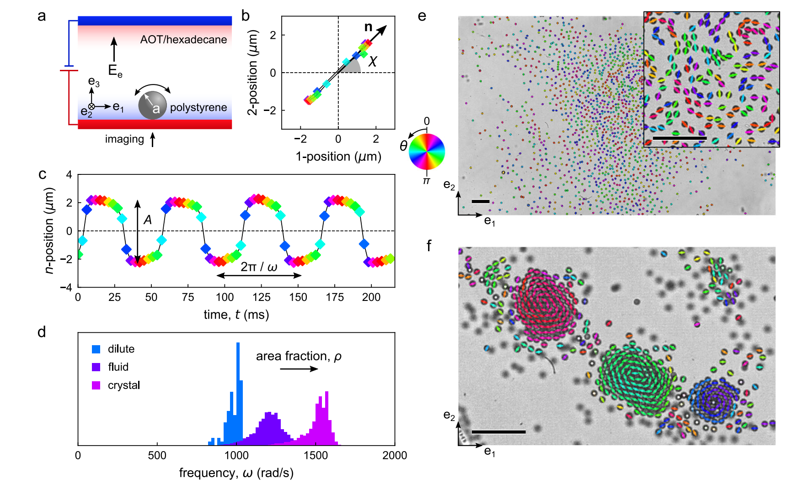
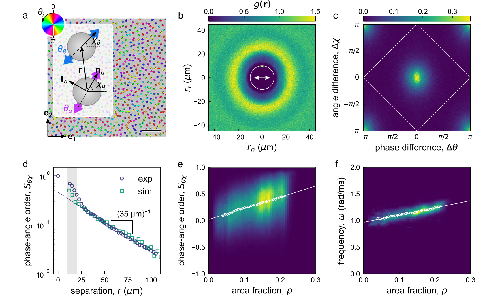

# 文献摘要

## Self-oscillating synchronematic colloids

通过改变初始颗粒的分布，发现了三种不同的组织模式，它们有不同的特征频率：1、稀疏的无相互吸引的颗粒，2、局部相关的流体团，3、拥有晶体结构的振荡簇。（见上图d）在更高的面积分数下，根据颗粒的初始分布，形成不同的结构，见 e 中初始均匀分布颗粒形成延展的流体状团簇，见 f 初始分布具有局部密集区域形成致密晶体成分。图中颗粒被画作带颜色的椭圆，用于标识振动方向与相位。

在 fluid cluster（e）中，振荡颗粒之间的相互作用导致它们的平均频率上升。在放大区域，颗粒平均分布，局部密度保持不变，系统进入准稳态。但是当初始包含高密度区时，颗粒形成离散的晶体团，形成圆形对齐的同时振荡同步，推测电渗流帮助颗粒“聚在一起”，颗粒间的流体动力学耦合则使它们的振荡同步。

使用 Stokesian Dynamics 进行模拟，分为远场的多级展开以及近场的润滑理论修正。

### Fluid clusters

先做双体研究，每一对振子 $\alpha, \beta$ 使用位移向量 $\mathbf{r}=\mathbf{x}_\beta-\mathbf{x}_\alpha，相位差 \Delta\theta=\theta_\beta-\theta_\alpha$，以及振子角度 $\chi_\beta, \chi_\alpha$ 表征。二维对相关函数 $g(r)$ 表现出流体结构，在 $r=25\mu m=5a$ 处有一个单峰（此处找到另一个颗粒的概率最大），接近指定面积分数 $\rho=0.11$ 下颗粒的最大中心间距 $5.62a$。虽然颗粒本身的振荡是各项异性的，但 $g(\mathbf{r})$ 的分布确实各向同性的。

- $g(\mathbf r)=1$：该位置出现邻居的概率与均匀随机分布相同；
- $g(\mathbf r)>1$：邻居更容易出现在这里；
- $g(\mathbf r)<1$：邻居较少出现在这里。

见上图 c，对于临近的颗粒（$r<4a$），相位和角度差异直方图在中心有一个尖峰，对应着向同步（$\Delta\theta\rightarrow 0$）与对齐（$\Delta\chi\rightarrow 0$）的强烈趋势。而且这一部分的长宽差不多，预示着同步与对齐背后很可能是同样的机制。为了定量表示这种相关同步性，定义序参量 $S_\theta\chi=<\cos\Delta\theta\cos\Delta\chi>$，根据振子对以及时间取平均。上图 c 中实验数据对应该值为 0.57。

见上图 d，该序参量随着距离的增加指数减小：$S_\theta\chi\propto e^{-r/\ell}$，存在一个特征长度 $\ell$，距离超过它时振子相位与方向就变得无关。而且该特征长度随着旋转扩散系数 $D_\chi$（指颗粒振荡轴方向的随机变化）下降，该长度上升，直至整个仿真域中的全局相关。

在仿真中，$\ell$ 从水动相互作用与旋转扩散的竞争中产生，可以通过**由外场驱动振荡产生的旋转扩散 $D_\chi$** 和**临近振荡颗粒产生的二次流造成的旋转**中简单估计该长度尺寸。一个由力矩 $T$ 驱动、在壁面附近滚动的球，会扰动周围流体，远场涡量尺度

$$
|\nabla\times\mathbf u|
\sim\frac{6aT}{8\pi\eta r^4},
$$

球体随局部流动转动的角速度，在这里近似取局部涡量的一半，因此

$$
\Omega_{\mathrm H}(r)
\sim\frac{3aT}{8\pi\eta r^4}.
$$

旋转扩散满足
$$
\left\langle[\Delta\chi(t)]^2\right\rangle=2D_\chi t.
$$
因此，让方向随机改变约一个弧度所需的时间，量级为
$$
t_{\mathrm D}\sim\frac{1}{D_\chi}.
$$
而流体作用让方向改变相同量级所需的时间为
$$
t_{\mathrm H}(r)\sim\frac{1}{\Omega_{\mathrm H}(r)}.
$$

于是：
- 距离较近时，$t_{\mathrm H}<t_{\mathrm D}$：流体耦合有机会在随机扰动打乱方向前协调颗粒；
- 距离较远时，$t_{\mathrm H}>t_{\mathrm D}$：随机扰动占优势，关联难以维持。
令两者在 $r=\ell$ 时相当，即
$$
\Omega_{\mathrm H}(\ell)\sim D_\chi,
$$
得到
$$
\boxed{
\ell\sim
\left(\frac{3aT}{8\pi\eta D_\chi}\right)^{1/4}.
}
$$

特征力矩
$$
T=
\frac{8\pi\eta a^3}{\tau_{\mathrm{mw}}}
\sqrt{\left(\frac{E_e}{E_c}\right)^2-1},
$$
其中 $\tau_{\mathrm{mw}}$ 是电荷的 Maxwell–Wagner 弛豫时间，$E_e$ 是外电场，$E_c$ 是旋转阈值电场。由此可以估算出 $\ell\simeq 9a$。

另外增加颗粒密度有利于增加关联序参量以及频率的上升（近乎线性）。