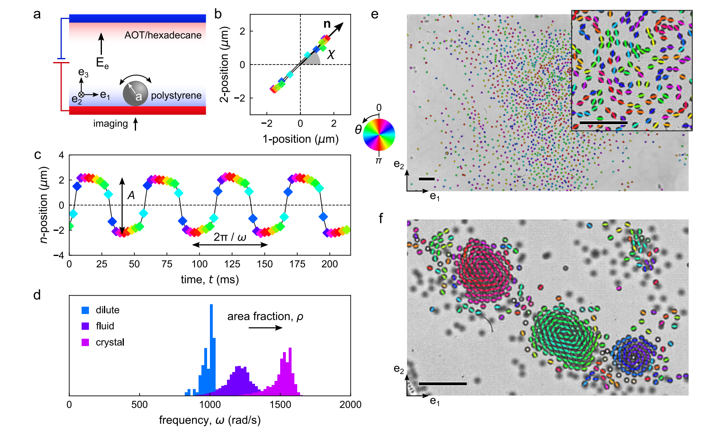
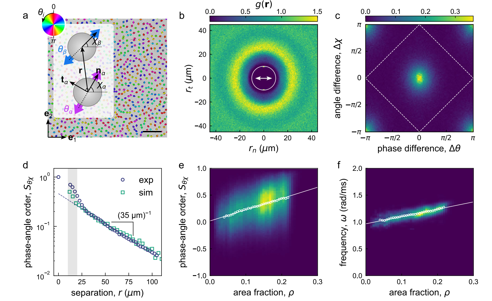
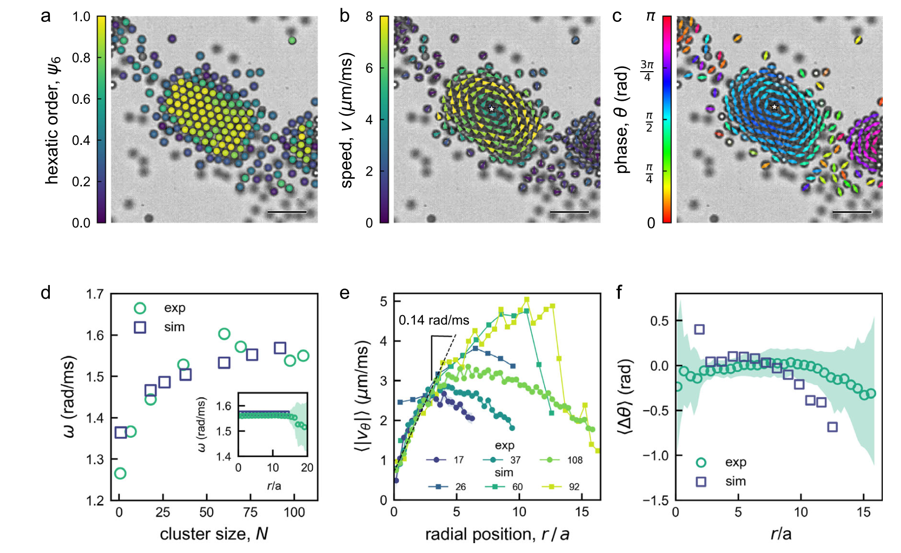
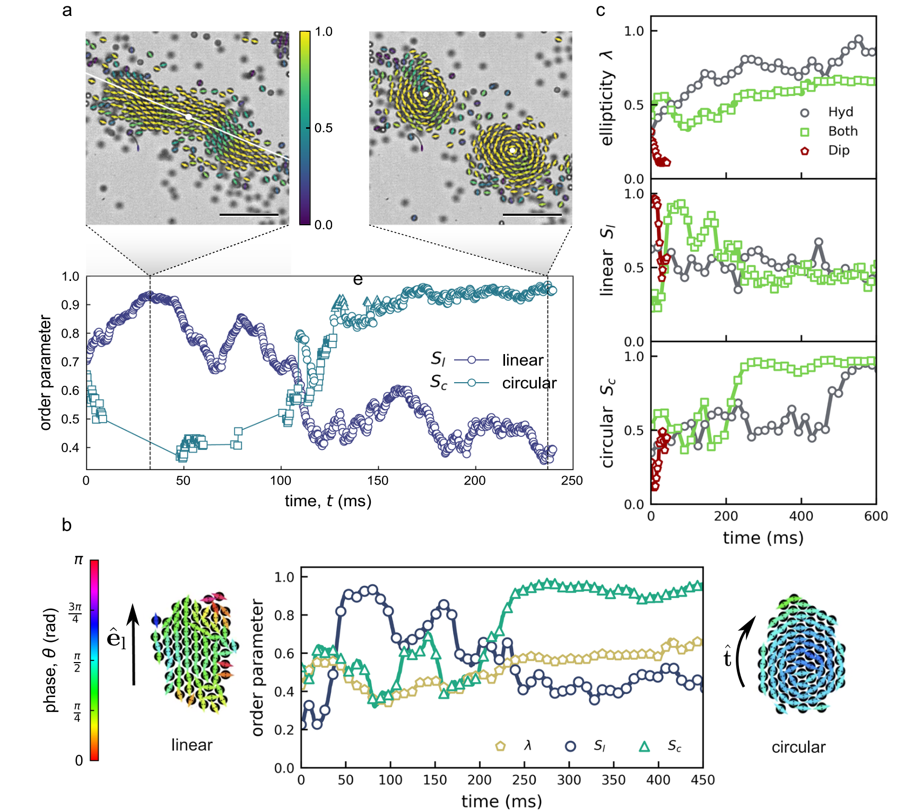
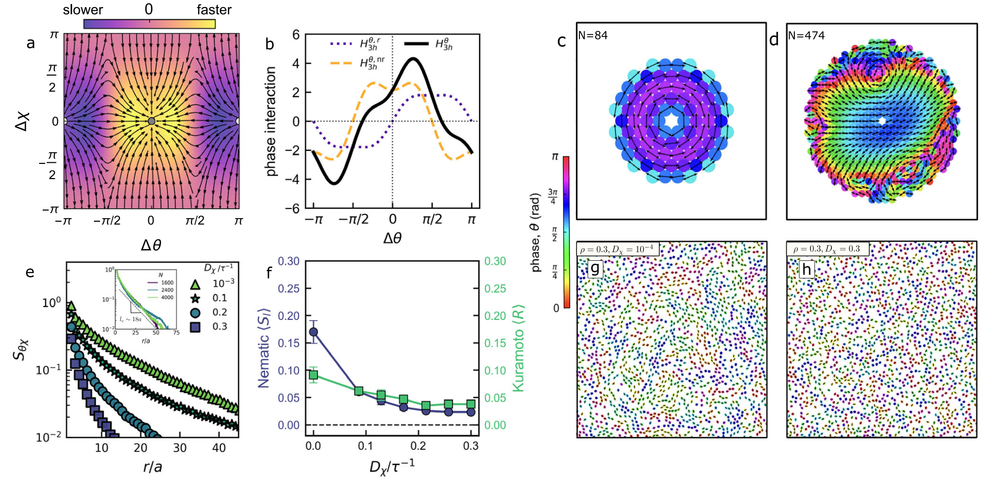

# 文献摘要

## Self-oscillating synchronematic colloids

通过改变初始颗粒的分布，发现了三种不同的组织模式，它们有不同的特征频率：1、稀疏的无相互吸引的颗粒，2、局部相关的流体团，3、拥有晶体结构的振荡簇。（见上图d）在更高的面积分数下，根据颗粒的初始分布，形成不同的结构，见 e 中初始均匀分布颗粒形成延展的流体状团簇，见 f 初始分布具有局部密集区域形成致密晶体成分。图中颗粒被画作带颜色的椭圆，用于标识振动方向与相位。

在 fluid cluster（e）中，振荡颗粒之间的相互作用导致它们的平均频率上升。在放大区域，颗粒平均分布，局部密度保持不变，系统进入准稳态。但是当初始包含高密度区时，颗粒形成离散的晶体团，形成圆形对齐的同时振荡同步，推测电渗流帮助颗粒“聚在一起”，颗粒间的流体动力学耦合则使它们的振荡同步。

使用 Stokesian Dynamics 进行模拟，分为远场的多级展开以及近场的润滑理论修正。

### Fluid clusters

先做双体研究，每一对振子 $\alpha, \beta$ 使用位移向量 $\mathbf{r}=\mathbf{x}_\beta-\mathbf{x}_\alpha，相位差 \Delta\theta=\theta_\beta-\theta_\alpha$，以及振子角度 $\chi_\beta, \chi_\alpha$ 表征。二维对相关函数 $g(r)$ 表现出流体结构，在 $r=25\mu m=5a$ 处有一个单峰（此处找到另一个颗粒的概率最大），接近指定面积分数 $\rho=0.11$ 下颗粒的最大中心间距 $5.62a$。虽然颗粒本身的振荡是各项异性的，但 $g(\mathbf{r})$ 的分布确实各向同性的。

- $g(\mathbf r)=1$：该位置出现邻居的概率与均匀随机分布相同；
- $g(\mathbf r)>1$：邻居更容易出现在这里；
- $g(\mathbf r)<1$：邻居较少出现在这里。

见上图 c，对于临近的颗粒（$r<4a$），相位和角度差异直方图在中心有一个尖峰，对应着向同步（$\Delta\theta\rightarrow 0$）与对齐（$\Delta\chi\rightarrow 0$）的强烈趋势。而且这一部分的长宽差不多，预示着同步与对齐背后很可能是同样的机制。为了定量表示这种相关同步性，定义序参量 $S_\theta\chi=<\cos\Delta\theta\cos\Delta\chi>$，根据振子对以及时间取平均。上图 c 中实验数据对应该值为 0.57。

见上图 d，该序参量随着距离的增加指数减小：$S_\theta\chi\propto e^{-r/\ell}$，存在一个特征长度 $\ell$，距离超过它时振子相位与方向就变得无关。而且该特征长度随着旋转扩散系数 $D_\chi$（指颗粒振荡轴方向的随机变化）下降，该长度上升，直至整个仿真域中的全局相关。

在仿真中，$\ell$ 从水动相互作用与旋转扩散的竞争中产生，可以通过**由外场驱动振荡产生的旋转扩散 $D_\chi$** 和**临近振荡颗粒产生的二次流造成的旋转**中简单估计该长度尺寸。一个由力矩 $T$ 驱动、在壁面附近滚动的球，会扰动周围流体，远场涡量尺度

$$
|\nabla\times\mathbf u|
\sim\frac{6aT}{8\pi\eta r^4},
$$

球体随局部流动转动的角速度，在这里近似取局部涡量的一半，因此

$$
\Omega_{\mathrm H}(r)
\sim\frac{3aT}{8\pi\eta r^4}.
$$

旋转扩散满足
$$
\left\langle[\Delta\chi(t)]^2\right\rangle=2D_\chi t.
$$
因此，让方向随机改变约一个弧度所需的时间，量级为
$$
t_{\mathrm D}\sim\frac{1}{D_\chi}.
$$
而流体作用让方向改变相同量级所需的时间为
$$
t_{\mathrm H}(r)\sim\frac{1}{\Omega_{\mathrm H}(r)}.
$$

于是：
- 距离较近时，$t_{\mathrm H}<t_{\mathrm D}$：流体耦合有机会在随机扰动打乱方向前协调颗粒；
- 距离较远时，$t_{\mathrm H}>t_{\mathrm D}$：随机扰动占优势，关联难以维持。
令两者在 $r=\ell$ 时相当，即
$$
\Omega_{\mathrm H}(\ell)\sim D_\chi,
$$
得到
$$
\boxed{
\ell\sim
\left(\frac{3aT}{8\pi\eta D_\chi}\right)^{1/4}.
}
$$

特征力矩
$$
T=
\frac{8\pi\eta a^3}{\tau_{\mathrm{mw}}}
\sqrt{\left(\frac{E_e}{E_c}\right)^2-1},
$$
其中 $\tau_{\mathrm{mw}}$ 是电荷的 Maxwell–Wagner 弛豫时间，$E_e$ 是外电场，$E_c$ 是旋转阈值电场。由此可以估算出 $\ell\simeq 9a$。

另外增加颗粒密度有利于增加关联序参量以及频率的上升（近乎线性）。

### Synchronematic crystals

**Hexatic order parameter**（$\psi_6$）通常译为“六重键取向序参量”，用于衡量二维颗粒排列是否具有局部六重对称性。可以把它理解为：一个颗粒周围的邻居，是否大致沿着六个相隔 $60^\circ$ 的方向排列。定义：

$$
\psi_6(i)=\frac{1}{N_i}
\sum_{j\in\mathcal N_i}
e^{\,6\mathrm i\alpha_{ij}},
$$

在向列相同步晶体中，会有较高的局部六重有序（见下图a），其中颗粒沿着圆形轨迹做前后运动（见下图b），而且它们以同样的频率以相同的相位差运动（见下图c）。最中心区域的颗粒会像刚体一样旋转，所以运动速度会随着里中心距离增加而线性增大，直至振荡幅值（见下图e）；同时振荡相位也会随着距离缺陷中心距离 $r$ 的变化而变化（见下图f），这是由相位上互易的相互作用（可以促进局部同步）以及非互易相互作用（增强振荡频率）的竞争。

### Linear vs. circular ordering

取决于初始分布，颗粒还能发展成线性有序，随着时间迁移，这种线性振荡模式变得不稳定，从而生成两个子聚团（见下图a）。为了定量表述这种转变，引入了两个额外的序参量：线性序参量 $S_l=1/2<\cos(2(\chi-\chi_0))+1>$，圆形序参量 $S_c=1/2<\cos(2(\chi-\mu-\pi/2))>$，其中 $\mu$ 是每个颗粒位置关于中心的方位角。下图 b 为仿真结果。

省略偶极（静电）或流体动力学相互作用的其他模拟表明，这两者对于从线性到圆形有序的急剧转变都是必不可少的（见下图c）。当只有静电作用时，产生瞬时的线性排布，但是聚团会立刻失稳并分解；另一方面，只有流体作用时，聚团缓慢发展成为圆形。以上观察可以说明，偶极子偏爱长轴排列，而流体作用驱动向漩涡状排布的转变。

### Reduced-order swarmalator model for Quincke oscillators

基于弱耦合的振子理论，提出了一个约化模型，以解释振子相位以及方向的发展。这里关注流体作用力的主要阶次 $d^{-3}$，为了简化还忽略了静电作用（量级为$d^{-4}$，相对来说比较弱，而且不会造成模型中发现的相位-角度耦合）。

考虑单颗粒的状态，可以写为：

$$
\boxed{
\mathbf Y(t)\approx
\mathbf Y_{\mathrm{LC}}
\bigl(\theta(t),\chi(t),\mathbf x(t)\bigr).
}
$$

先研究两个颗粒 $\alpha,\beta$。颗粒相距足够远时，邻居对单颗粒的扰动较弱：

$$
\boxed{
\dot{\mathbf Y}_{\alpha}
=
\mathbf F(\mathbf Y_{\alpha})
+
d^{-3}\mathbf I_3
(\mathbf Y_{\alpha},\mathbf Y_{\beta})
+
O(d^{-4}).
}
$$

对于相位有：

$$
\dot{\theta}_\alpha
=
\omega+
d^{-3}
\mathbf Z_\theta\cdot
\mathbf I_3
+
O(d^{-4}).
$$

其中 $Z_\theta$ 为相位响应函数：

$$
\delta\theta
\approx
\mathbf Z_\theta\cdot\delta\mathbf Y.
$$

使用伴随方法求解：

$$
\frac{\mathrm d\mathbf Z}{\mathrm dt}
=
-\mathbf J^{\mathsf T}(t)\mathbf Z,
\qquad
\mathbf J(t)
=
\left.
\frac{\partial\mathbf F}{\partial\mathbf Y}
\right|_{\mathbf Y_{\mathrm{LC}}}.
$$

总之是从实验数据里拟合出来（响应函数是个多项式，拟合其系数）：

$$
\boxed{
\begin{aligned}
\dot{\theta}_i
&=
\omega+
\sum_{j\ne i}d_{ij}^{-3}
H^\theta(\psi_i,\psi_j,\theta_j-\theta_i)
+\sqrt{2D_\theta}\,\xi_i^\theta,\\
\dot{\chi}_i
&=
\sum_{j\ne i}d_{ij}^{-3}
H^\chi(\psi_i,\psi_j,\theta_j-\theta_i)
+\sqrt{2D_\chi}\,\xi_i^\chi.
\end{aligned}
}
$$

$$
\begin{aligned}
\dot{\phi}_\alpha
&=
d^{-3}H_3^\phi(\psi_\alpha,\psi_\beta,\Delta\phi)
+O(d^{-4}),\\
\dot{\chi}_\alpha
&=
d^{-3}H_3^\chi(\psi_\alpha,\psi_\beta,\Delta\phi)
+O(d^{-4}),\\
\dot{\mathbf x}_\alpha
&=O(d^{-4}).
\end{aligned}
$$

$$
f_q(\Delta\theta)
=
A_1^q\cos\Delta\theta
+B_1^q\sin\Delta\theta
+A_3^q\cos3\Delta\theta
+B_3^q\sin3\Delta\theta,
\qquad q=\theta,\chi.
$$

**周期平均**得到的 $H$ 是数值函数。作者再利用周期性、镜像对称性，以及前面讨论过的相位—取向对称性，筛选允许的 Fourier 项，并拟合系数。

相互作用函数揭示了流体动力学耦合如何不仅驱动**同步和对准**，而且驱动相互作用振子之间的**相互加速**（频率上，见下图a，箭头表示$
\left(\frac{\mathrm d\Delta\theta}{\mathrm dt},
\frac{\mathrm d\Delta\chi}{\mathrm dt}\right)
$）。这种非互易作用可见下图b，对于同向的振子（$\psi_\alpha=\psi_\beta=0$）的相位吸引函数关于相位的变化（其分解为奇函数和偶函数两个部分，其中奇函数部分，也就是紫色虚线，负责同步，偶函数部分，也就是橙色虚线，负责共同提频）。这一部分称为“非互易”，因为交换两个振子后，这个频率修正不反号：可以是双方都被加速，而不是一方加速、另一方等量减速。这里指的是约化相位动力学中的非互易性，不是直接说两颗粒的机械力违反作用力与反作用力关系。

使用这个约化模型，还复现了锁相的圆形对齐（见下图c）以及无序流体相的局部同步（见下图e-h）。在某个特征尺寸之上，全局的锁相以及圆形对齐被打破，产生了局部的同步与线性排列（见下图d）。

由于上述非互易作用的存在（颗粒频率的提高）即使没有随机噪声，颗粒也不一定能实现整体同步和方向一致（见下图f）。颗粒密度越高的区域频率越高。比如将颗粒放在固定晶格上，或者保留无序位置，但去掉非互易相位耦合，都能获得准长程关联。

